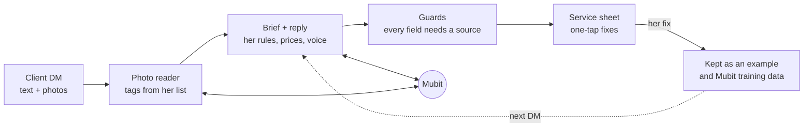

<h1 align="center">Brief Builder</h1>

<p align="center"><b>Turn “can u do these?” into a booking.</b><br>
A stylist’s DM inbox that drafts priced replies in her voice, and learns from every fix she makes.</p>

<p align="center">
  <a href="https://brief-builder.buy-ea2.workers.dev/s/braider">Try it as a client</a> ·
  <a href="#how-it-works">How it works</a> ·
  <a href="#results">Results</a>
</p>


Clients DM a photo and three words. Before anything gets booked, the stylist has to ask what they
want, work out the price and find a time. Brief Builder reads the message and the photo, fills a
service sheet from **her** price list and house rules, and drafts the reply. She fixes anything with
one tap, and the next draft already knows. Built at Night Shift, London, October 2026. Every model
call goes through [Mubit](https://mubit.ai).

## How it works



- **Nothing invented.** Each field must quote the DM or a confident photo tag, or it’s cleared.
  Prices come from her price list, never from the model.
- **Her fixes teach it.** A fix is kept, and the closest past fixes guide the next drafts. The
  re-drafted reply goes through Mubit, so her corrected answers train her own adapter.
- **Her voice.** When she rewrites a draft before sending, the next drafts follow how she writes.
- **Photos like this one.** A photo fix applies only to new photos that look like the one she fixed.
- **The conversation keeps going.** Follow-ups build on what’s settled. If a fix changes a price she
  already sent, it offers the client a one-tap correction.
- **A closest yes for every no.** Over budget, or a service she doesn’t do, the sheet offers the
  nearest thing she can say yes to, from her price list.

| The client | The closest yes | The stage |
| --- | --- | --- |
|  |  |  |

## Results

Locked test DMs, never sent to Mubit for training. Fully right means every field of the brief matches.

| Stylist | Test DMs | Plain model | With her fixes |
| --- | --- | --- | --- |
| Amara Braids, braider | 60 | 28% | **52%** |
| Lived-in Colour, colourist | 20 | 0% | **35%** |
| Gloss by Jade, nail tech | 24 | 29% | **58%** |

## Run it

```bash
pnpm install
printf 'MUBIT_API_KEY=...\nSTYLIST_TOKEN=...\n' > .dev.vars
pnpm run dev
```

Then open `/s/braider` as a client, `/inbox/braider` as the stylist and `/stage` on a projector.

<sub>TanStack Start on Cloudflare Workers · one Durable Object per stylist · Effect Schema · launch film in
`video/` (Remotion). Photo credits in `public/work/CREDITS.md`.</sub>
