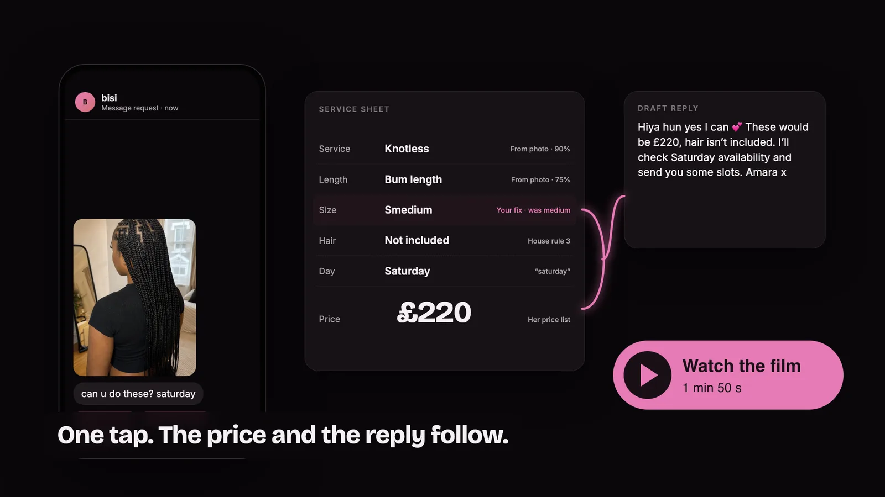
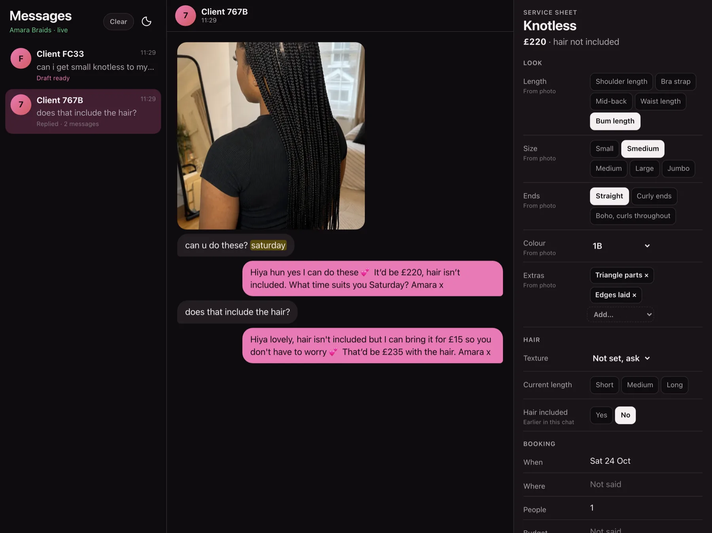
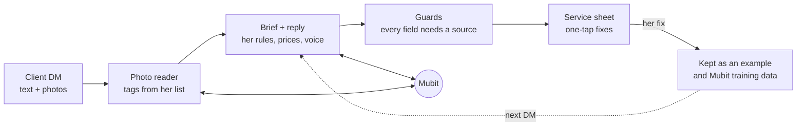
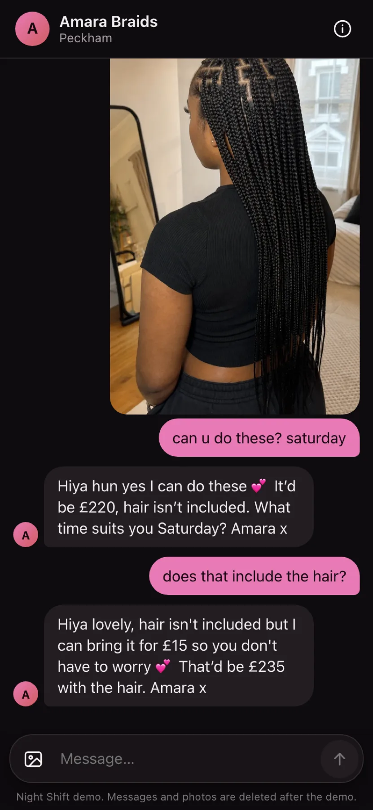
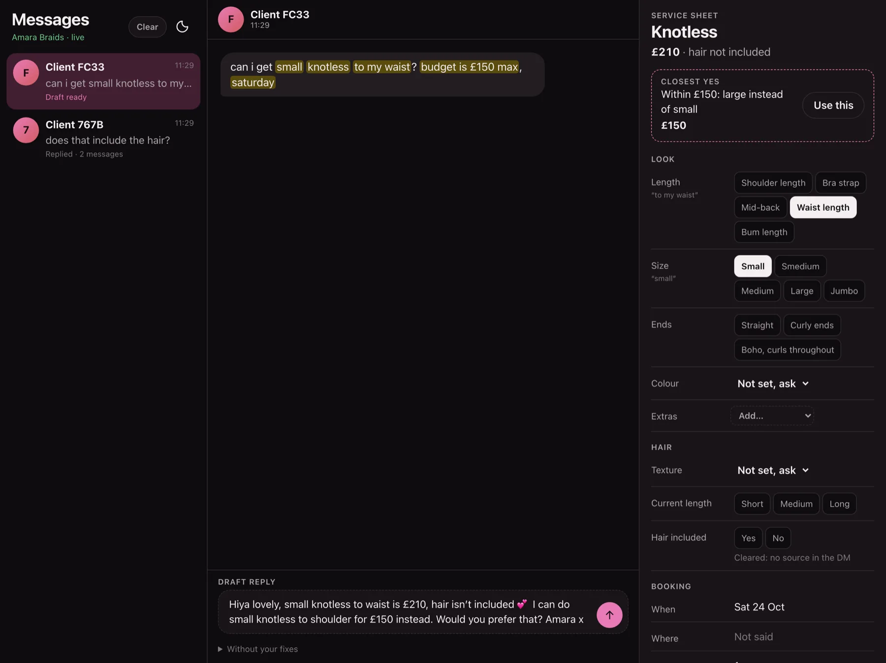
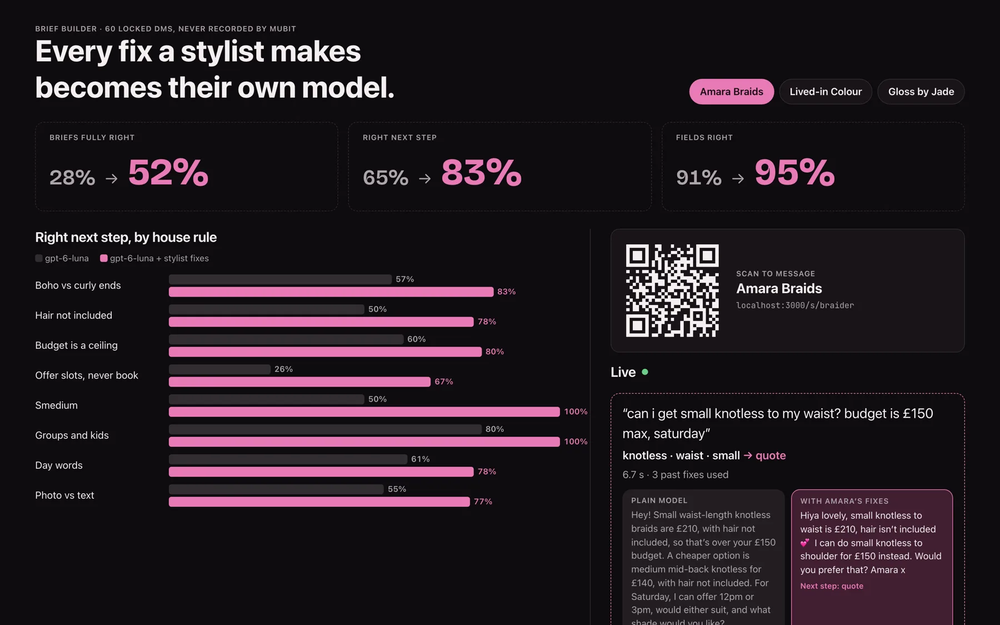

<h1 align="center">Brief Builder</h1>

<p align="center"><b>Turn “can u do these?” into a booking.</b><br>
A stylist’s DM inbox that drafts priced replies in her voice, and learns from every fix she makes.</p>

<p align="center">
  <a href="https://brief-builder.buy-ea2.workers.dev/s/braider">Try it as a client</a> ·
  <a href="https://github.com/machineyearningengineer/brief-builder/releases/download/v1.0/brief-builder-launch.mp4">Watch the film</a> (<a href="https://github.com/machineyearningengineer/brief-builder/releases/download/v1.0/brief-builder-mobile.mp4">upright</a>, <a href="https://github.com/machineyearningengineer/brief-builder/releases/download/v1.0/brief-builder-story.mp4">60-second cut</a>) ·
  <a href="https://github.com/machineyearningengineer/brief-builder/releases/download/v1.0/brief-builder-deck.pdf">Deck (PDF)</a> ·
  <a href="#how-it-works">How it works</a> ·
  <a href="#results">Results</a>
</p>

[](https://github.com/machineyearningengineer/brief-builder/releases/download/v1.0/brief-builder-launch.mp4)



Clients DM a photo and three words. Before anything gets booked, the stylist has to ask what they
want, work out the price and find a time. Brief Builder reads the message and the photo, fills a
service sheet from **her** price list and house rules, and drafts the reply. She fixes anything with
one tap, and the next draft already knows. Built at Night Shift, London, October 2026. Every model
call goes through [Mubit](https://mubit.ai).

## How it works



- **Nothing invented.** Each field must quote the DM or a confident photo tag, or it’s cleared.
  Prices come from her price list, never from the model.
- **Her fixes teach it.** A fix is kept, and the closest past fixes guide the next drafts. The
  re-drafted reply goes through Mubit, so her corrected answers train her own adapter.
- **Her voice.** When she rewrites a draft before sending, the next drafts follow how she writes.
- **Photos like this one.** A photo fix applies only to new photos that look like the one she fixed.
- **The conversation keeps going.** Follow-ups build on what’s settled. If a fix changes a price she
  already sent, it offers the client a one-tap correction.
- **One tap books it.** When the client picks a time, “Confirm booking” sends them the day, time,
  what’s booked and the total from her price list, and the stage shows it as booked.
- **The room sees every state.** The stage shows drafting, her draft, re-drafting with her fix (the old
  value struck through, the new price picked out), sent, and booked, with a Live/Reconnecting/Offline pill.
- **A closest yes for every no.** Over budget, or a service she doesn’t do, the sheet offers the
  nearest thing she can say yes to, from her price list.

| The client | The closest yes | The stage |
| --- | --- | --- |
|  |  |  |

## Results

Locked test DMs, never sent to Mubit for training. Fully right means every field of the brief matches.
With her fixes, each set was run three times; the table shows the middle run, the range in brackets.

| Stylist | Test DMs | Plain model | With her fixes | + her rules in code |
| --- | --- | --- | --- | --- |
| Amara Braids, braider | 60 | 30% | 47% | **85%** (85–90) |
| Lived-in Colour, colourist | 20 | 15% | 45% | **90%** (85–95) |
| Gloss by Jade, nail tech | 24 | 25% | 46% | **92%** (92–96) |

Her rules in code decide the next step, what’s missing, dates and time windows, a clash between
photo and text, and her yes-or-no rules: wig installs declined, children referred, a consultation
for box-dyed hair, the soak-off for another salon's gel, a new set after three weeks
(`src/shared/decide.ts`). `pnpm rules:check` proves they agree with every label she has written,
training sets and saved corrections; only then are the locked sets scored.

## How the code is organised

| Where | What it owns |
| --- | --- |
| `src/server/room.ts` | One Durable Object per stylist: DMs, photos, drafts, fixes, threads, live updates |
| `src/server/mubit.ts` | Every Mubit call: per-attempt and overall time limits, typed errors (Effect), jittered retries only for rate limits, server errors and timeouts |
| `src/server/brief-call.ts`, `photo-reader.ts` | The two model calls, both through Mubit |
| `src/server/brief-prompt.ts` | Her instructions, built only from her profile, so each stylist is one Mubit task |
| `src/server/guards.ts` | Every field needs a source; settled fields carry through a conversation |
| `src/server/corrections.ts` | Her closest fixes and her voice, as worked examples |
| `src/shared/decide.ts` | What code decides exactly: next step, missing info, dates, time windows |
| `src/shared/pricing.ts` | Prices and the closest yes, from her price list |
| `src/shared/brief.ts` | The brief schema (Effect Schema), shared by server, screens and scoring |
| `src/routes/` | The client chat (`s.$stylist`), her inbox (`inbox.$stylist`), the stage |
| `data/<stylist>/` | Her profile, tag list, seed fixes, voice examples, training DMs and locked test |
| `scripts/` | Replay and score the locked tests, send training batches, check the data |

## When things go wrong

- **Slow or failing model calls** retry with backoff when it's worth it, and fail fast when it isn't (`scripts/check-mubit-client.ts` proves each case against a misbehaving stand-in).
- **A restart mid-draft** can't leave a message stuck: drafts in flight are recorded in the room's SQLite, and a Durable Object alarm retries once, then marks the draft failed, where "Try again" and a reply-by-hand box are waiting.
- **Retried sends** don't duplicate DMs: each one carries a key the room checks.
- **Overlapping work** doesn't overwrite newer changes: drafts merge into the stored message, and only the newest fix's re-draft is applied.

## Run it

```bash
pnpm install
printf 'MUBIT_API_KEY=...\nSTYLIST_TOKEN=...\n' > .dev.vars
pnpm run dev
```

Then open `/s/braider` as a client, `/inbox/braider` as the stylist and `/stage` on a projector.

<sub>TanStack Start on Cloudflare Workers · one Durable Object per stylist · Effect Schema · launch film in
`video/` (Remotion). Photo credits in `public/work/CREDITS.md`.</sub>
